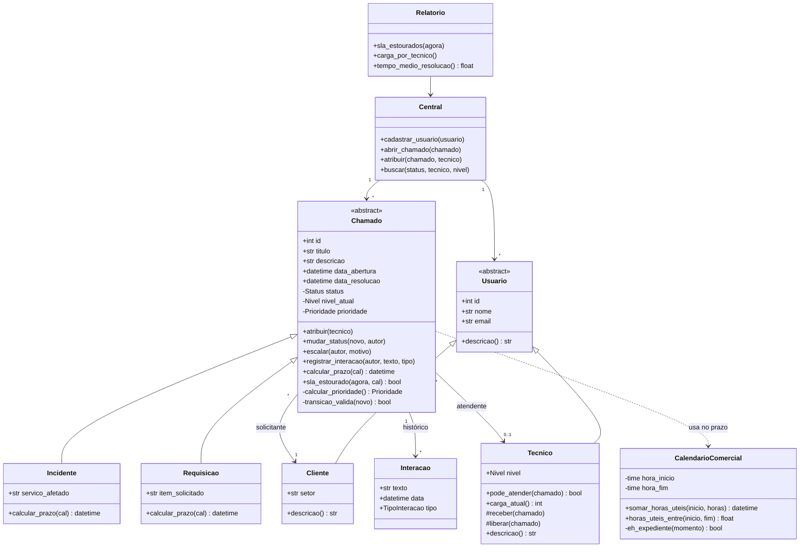

<div align="center">

# 🎧 Mini Help Desk

**Sistema de gestão de chamados de suporte de TI, feito em Python orientado a objetos**


[📄 Documentação técnica (PDF)](Documenta%C3%A7%C3%A3o%20Mini%20HelpDesk.pdf)

</div>

---

## 📌 Sobre o projeto

O **Mini Help Desk** organiza todo o ciclo de vida de um chamado de suporte: abertura pelo cliente, triagem de prioridade, atribuição a um técnico, escalonamento entre níveis, resolução e fechamento, com controle de prazos (SLA) e histórico completo de interações.

Projeto final da disciplina de Programação Orientada a Objetos, desenvolvido 100% em Python.

### O problema

Equipes pequenas de suporte costumam controlar chamados em planilhas ou conversas de mensagens: sem prioridade definida por critério, sem histórico confiável e sem visibilidade de prazos estourados. O sistema troca esse controle informal por regras explícitas e relatórios.

O modelo foi inspirado em ferramentas de gestão de serviços de TI, como o GLPI (tipos de chamado, ciclo de status, SLA e prioridade por urgência e impacto), em uma versão enxuta, offline e didática.

---

## ✨ Funcionalidades

- 🆕 Abrir chamado do tipo **Incidente** ou **Requisição**, com prioridade calculada automaticamente
- 📋 Listar chamados com prioridade, nível, status, técnico e prazo
- 👤 Atribuir chamado a um técnico, respeitando o nível de atendimento
- ⬆️ **Escalar** chamado de N1 para N2, devolvendo-o à fila
- ✅ Resolver e fechar chamados, com validação do ciclo de status
- 🕘 Consultar detalhes e **histórico completo** de cada chamado
- 📊 Relatórios: SLA estourado, carga por técnico e tempo médio de resolução

---

## 🧠 Regras de negócio

### Níveis de suporte

| Nível | Atendimento | Tipo de problema |
|:---:|---|---|
| **N1** | Telefone | Problemas simples |
| **N2** | Presencial | Problemas complexos e os que o N1 não resolveu (ex.: troca de ponteira RJ45) |

Todo chamado nasce em N1. Se o técnico N1 não consegue resolver, ele **escala**: o chamado sobe para N2, perde o técnico, volta para a fila e o motivo fica gravado no histórico.

### Prioridade calculada

A prioridade não é digitada. Ela sai da soma entre **urgência** (1 a 3) e **impacto** (1 a 3):

| Soma | Prioridade |
|:---:|:---:|
| 2 ou 3 | BAIXA |
| 4 | MÉDIA |
| 5 | ALTA |
| 6 | CRÍTICA |

### Ciclo de status

```
Aberto ──► Em atendimento ──► Solucionado ──► Fechado
               │   ▲               │
               ▼   │               └──► (reabertura) Em atendimento
             Pendente
```

Transições fora desse fluxo (por exemplo, fechar um chamado ainda aberto) são barradas pelo sistema.

### SLA em horas comerciais

Os prazos contam apenas **horas úteis** (segunda a sexta, das 8h às 18h):

| Tipo | Prioridade | Prazo |
|---|:---:|:---:|
| Incidente | Crítica | 4 h |
| Incidente | Alta | 8 h |
| Incidente | Média | 16 h |
| Incidente | Baixa | 24 h |
| Requisição | qualquer | 40 h (5 dias úteis) |

Exemplo: um chamado aberto na sexta às 17h com prazo de 2 horas úteis vence na segunda às 9h.

---

## 🏗️ Arquitetura



> Legenda: `+` público · `-` privado · `#` restrito. No código, privados começam com `__` e restritos com `_`.

### Conceitos de POO aplicados

| Conceito | Onde |
|---|---|
| **Herança** | `Cliente` e `Tecnico` herdam de `Usuario`; `Incidente` e `Requisicao` herdam de `Chamado` |
| **Polimorfismo** | `calcular_prazo()` (incidente pela prioridade, requisição com prazo fixo) e `descricao()` |
| **Associação** | `Chamado` se liga a `Cliente`, `Tecnico` e `Interacao` |
| **Encapsulamento** | `__status`, `__nivel_atual` e `__prioridade` privados, lidos por `property` |
| **Método privado** | `__calcular_prioridade()` e `__transicao_valida()` |
| **Classes abstratas** | `Usuario` e `Chamado` (módulo `abc`) |

---

## 📁 Estrutura

| Arquivo | Responsabilidade |
|---|---|
| `main.py` | Programa principal: dados de exemplo, menu e interação |
| `chamados.py` | `Chamado`, `Incidente`, `Requisicao` e `Interacao` |
| `usuarios.py` | `Usuario`, `Cliente` e `Tecnico` |
| `calendario.py` | `CalendarioComercial` (prazos em horas úteis) |
| `central.py` | `Central` (dados em memória) e `Relatorio` |
| `enums.py` | Enumerações (status, urgência, impacto, prioridade, nível, tipo de interação) |
| `test_helpdesk.py` | Testes automatizados com pytest |

---

## 🚀 Como executar

Requisito: **Python 3.10 ou superior**. O sistema usa apenas a biblioteca padrão.

```bash
git clone https://github.com/BrunoFMalta/ProjetoPythonPOO.git
cd "ProjetoPythonPOO/HelpDesk Projeto"
python main.py
```

O menu aparece no terminal:

```
=== MINI HELP DESK ===
1. Abrir chamado
2. Listar chamados
3. Atribuir chamado a técnico
4. Escalar chamado (N1 -> N2)
5. Resolver chamado
6. Fechar chamado
7. Ver detalhes e histórico
8. Relatórios
0. Sair
```

O sistema já inicia com clientes, técnicos N1 e N2 e um chamado de exemplo carregados.

## 🗺️ Próximos passos

- [ ] Persistência dos dados em arquivo (JSON ou SQLite)
- [ ] Cadastro de clientes e técnicos pelo menu
- [ ] Refinamento visual da interface
- [ ] Expediente configurável e lista de feriados
- [ ] Segundo relógio de SLA (tempo até assumir o chamado)

---

## 👨‍💻 Autor

**Bruno Felipe Malta** · [@BrunoFMalta](https://github.com/BrunoFMalta)
